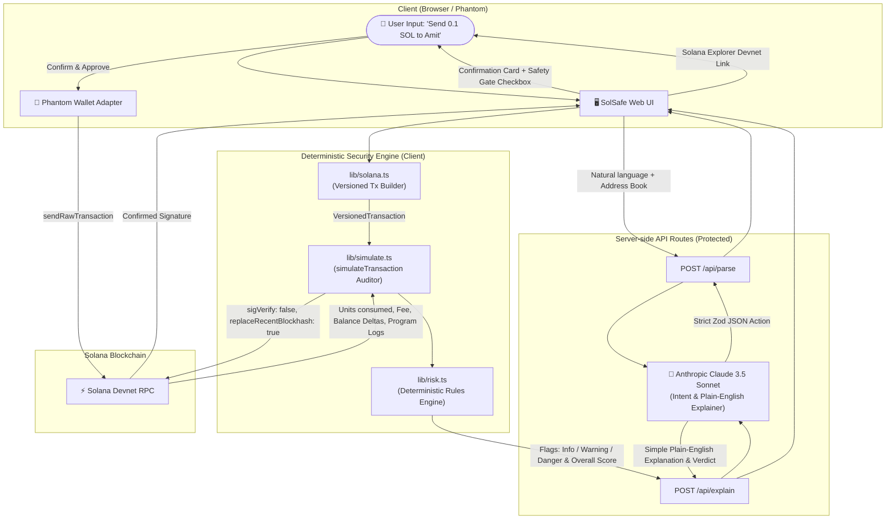

# SolSafe 🛡️
> **Understand before you sign.** A plain-English Solana wallet assistant with autonomous pre-signing transaction simulation, deterministic security checks, and AI explanations. Built for the AI Track Hackathon.

[](https://nextjs.org/)
[](https://solana.com/)
[](https://www.anthropic.com/)
[](https://www.typescriptlang.org/)
[](https://opensource.org/licenses/MIT)

---

## ⚡ Problem: Blind Signing in Web3
Millions of dollars are lost each month in Web3 due to **blind signing**. When a dApp or wallet asks a user to sign a transaction, the user is presented with raw hex, base58 strings, or obscure byte buffers. Users cannot easily tell:
- Who is actually receiving their funds?
- What percentage of their balance is being drained?
- Which smart contract programs are actually being invoked under the hood?
- Will this transaction leave enough rent for their account to survive?

**SolSafe fixes this.** It enables users to type commands in plain natural English (e.g., *"Send 0.1 SOL to Amit"*), converts intent into Solana VersionedTransactions, **simulates the execution on-chain before asking for a signature**, evaluates a **strictly deterministic risk engine**, and generates a **plain-English explanation** understandable by any non-technical user.

---

## 🚀 Architecture & End-to-End Pipeline



---

## 🛡️ Deterministic Risk Engine (`lib/risk.ts`)

SolSafe does **NOT** delegate critical safety decisions to non-deterministic LLMs. Instead, our deterministic risk engine audits hard rules:

1. **New Recipient Check (`warning` / `Review Needed`)**: Recipient has never been interacted with before (not in address book and no prior transaction history).
2. **Balance Drain Warning (`warning` / `Review Needed`)**: Transfer amount exceeds 50% of the sender's total balance.
3. **Critical Drain Alert (`danger` / `Risky`)**: Transfer amount exceeds 90% of the sender's balance.
4. **Untrusted Program Invocation (`danger` / `Risky`)**: Transaction invokes programs other than the standard System Program, SPL Token Program, Associated Token Program, or Compute Budget.
5. **Self-Transfer Warning (`warning` / `Review Needed`)**: Recipient is the sender's own connected wallet address.
6. **Rent Exemption Reserve (`danger` / `Risky`)**: Transfer leaves less than 0.002 SOL in the sender's wallet, jeopardizing future rent or transaction fees.
7. **Autonomous Daily Spending Cap (`danger` / `Risky`)**: Transaction pushes cumulative daily spend beyond the user-configured limit (stored in `localStorage`).

> 🚨 **Critical Safety Gate**: If any `danger` flag is triggered, the Confirm button is locked until the user explicitly checks *"I acknowledge the critical risk flags above and wish to proceed anyway."*

---

## ⚡ Why Solana?
SolSafe is uniquely powerful on Solana because of two architectural advantages:

1. **Ultra-Fast & Free Pre-Flight Simulation (`simulateTransaction`)**:
   Solana's JSON-RPC provides an exact on-chain simulation endpoint that executes the transaction against live state, computes units consumed (`CU`), logs program invocations, and returns balance modifications in **under 400ms** with zero gas costs.
2. **Sub-Second Finality & Micro-Fees**:
   Once confirmed, Solana settles transactions in ~400ms with typical network fees of ~0.000005 SOL ($0.001), enabling instant feedback loops that make safety checks viable for everyday retail users.

---

## 🛠️ Tech Stack
- **Framework**: Next.js 15 (App Router), TypeScript, Tailwind CSS v4
- **Solana Web3**: `@solana/web3.js`, `@solana/spl-token`, `@solana/wallet-adapter-react`, `@solana/wallet-adapter-react-ui`, `@solana/wallet-adapter-phantom`
- **AI / LLM**: Anthropic API (`claude-3-5-sonnet-20241022`) called **strictly server-side** (keys never exposed to the client)
- **Validation**: Zod schema validation for all intent outputs and API payloads
- **Testing**: Vitest unit testing suite for deterministic security rules

---

## 📦 Setup & Installation

### 1. Clone & Install
```bash
git clone https://github.com/your-username/solsafe.git
cd solsafe
npm install --legacy-peer-deps
```

### 2. Environment Variables
Copy `.env.example` to `.env.local`:
```bash
cp .env.example .env.local
```

Configure your variables in `.env.local`:
```env
# Solana RPC Endpoint (Devnet default)
NEXT_PUBLIC_SOLANA_RPC_URL=https://api.devnet.solana.com

# Anthropic API Configuration (Server-Side Only)
ANTHROPIC_API_KEY=your_anthropic_api_key_here
LLM_MODEL=claude-3-5-sonnet-20241022
```
*(Note: If `ANTHROPIC_API_KEY` is not provided, SolSafe seamlessly activates its built-in deterministic heuristic fallback so hackathon demos and reviews never break!)*

### 3. Run Unit Tests
```bash
npm test
```
All 7 unit tests in `test/risk.test.ts` verify the deterministic risk engine.

### 4. Run Development Server
```bash
npm run dev
```
Open [http://localhost:3000](http://localhost:3000) in your browser.

---

## 🌟 Hackathon Demo Mode (`/demo`)
Presenting at a hackathon where Devnet RPC or test wallets might be slow?
Navigate to:
```
http://localhost:3000/demo
```
The `/demo` mode provides 3 pre-seeded scenarios:
- **Scenario 1 (Safe)**: Send 0.1 SOL to saved contact Amit (Safe badge, 0 danger flags, clean explanation).
- **Scenario 2 (Review Needed)**: Send 0.7 SOL to Bob (70% balance warning flag, Review badge).
- **Scenario 3 (Risky)**: Send 5 SOL to Unknown Drainer (98% drain, new untrusted recipient, malicious program invocation, daily limit exceeded, required safety checkbox).

---

## 🔒 Security Best Practices
- **No Private Keys**: SolSafe never asks for, stores, or handles private keys. All signing occurs exclusively inside Phantom wallet.
- **Server-Side LLM Execution**: Anthropic API keys are restricted to server-side Next.js route handlers (`/api/parse` and `/api/explain`).
- **Input Validation**: All public keys are validated against the ed25519 curve using `PublicKey.isOnCurve()`.
