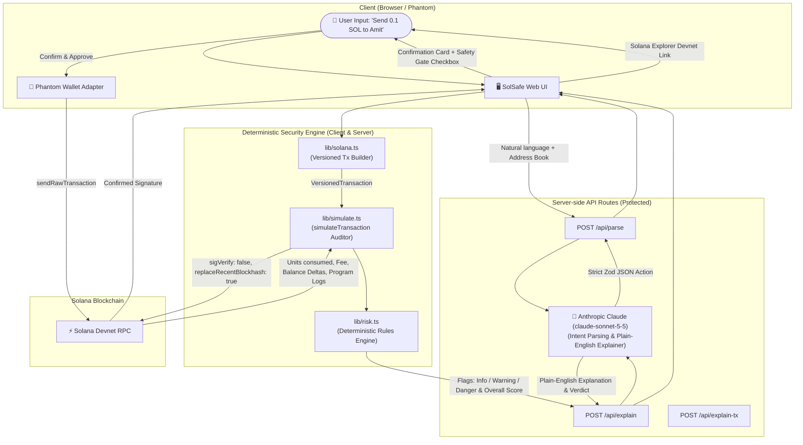

# SolSafe 🛡️
> **Understand before you sign.** A plain-English Solana wallet assistant with autonomous pre-signing transaction simulation, deterministic security checks, and plain-English AI explanations. Built for the AI Track Hackathon.

[](https://nextjs.org/)
[](https://solana.com/)
[](https://www.anthropic.com/)
[](https://www.typescriptlang.org/)
[](LICENSE)

---

## ⚡ The Challenge: Blind Signing in Web3
Blind signing remains one of the most widespread attack vectors in Web3. When approving a transaction, users are typically confronted with raw hex payloads, opaque base58 account keys, or raw bytecode. In many wallets, users cannot easily determine:
- Who is actually receiving their funds?
- What percentage of their total wallet balance is leaving the account?
- Which smart contract programs are actually being invoked under the hood?
- Will this transaction deplete rent reserves needed for future account survival?
- Does the target token have hidden transfer hooks, freeze authorities, or permanent delegates?

**SolSafe addresses this directly.** It lets users issue commands in natural English (e.g., *"Send 0.1 SOL to Amit"*), converts intent into Solana VersionedTransactions, **simulates the execution on-chain before prompting for signature**, audits a **deterministic security rules engine**, and generates a **plain-English explanation** with clear risk badges.

---

## 🚀 Architecture & End-to-End Pipeline



---

## 🛡️ Deterministic Risk Engine (`lib/risk.ts`)

SolSafe does **NOT** delegate critical safety decisions to non-deterministic LLMs. Instead, our deterministic risk engine audits hard rules:

1. **Real On-Chain Interaction Check**: Uses `getSignaturesForAddress` on the connected wallet to check whether the user has interacted with the recipient before on Devnet, complementing the address book.
2. **Recipient Account Checks**:
   - Program Execution Guard: Flags a danger alert if the destination account is an executable smart contract program.
   - Uninitialized Account Guard: Warns if the recipient is a new/empty account with 0 SOL and no prior on-chain history.
3. **Off-Curve / PDA Check**: Distinguishes standard curve keys from off-curve Program Derived Addresses (PDAs) with an advisory warning.
4. **Known Drainer / Scam Blacklist**: Evaluates recipient addresses against verified phishing drainer addresses.
5. **Balance Drain Warning**: Warns if the transfer amount exceeds 50% of the sender's balance, and triggers a critical danger alert if $\ge 90\%$.
6. **Rent Exemption Reserve Check**: Blocks transfers that would leave less than 0.002 SOL, protecting the account from eviction or stuck transaction states.
7. **Simulation Compute Anomaly**: Flags a danger alert if simulation consumes $> 200,000$ Compute Units (standard transfers use $< 1,000$ CU).
8. **SPL Token & Token-2022 Auditing**:
   - Active Mint Authority: Warns if token supply can be minted arbitrarily.
   - Active Freeze Authority: Warns if holder accounts can be frozen.
   - Token-2022 Extensions: Detects and flags `TransferHook`, `PermanentDelegate`, and `TransferFeeConfig` extensions.
9. **User-Set Advisory Daily Spending Cap**: Evaluates transactions against an advisory, user-configured daily cap stored in the browser.

> 🚨 **Critical Safety Gate**: If any `danger` flag is triggered, the Confirm button is locked until the user explicitly checks *"I acknowledge the critical risk flags above and wish to proceed anyway."*

---

## 🔍 Explain Any Transaction Mode (`/explain-tx`)

SolSafe includes a standalone Devnet transaction inspector available at `/explain-tx`:
- **Paste Any Signature**: Inspect any finalized Solana Devnet transaction signature.
- **On-Chain Delta Parsing**: Automatically calculates net balance changes (pre vs. post balances) for all accounts, extracts compute units consumed, and catalogues invoked program IDs.
- **AI & Safety Audit**: Runs deterministic risk analysis and feeds simulation data into the plain-English explanation engine.
- **Instant Test Chips**: Includes clickable pre-loaded Devnet transactions so judges and reviewers can test without needing a wallet connected.

---

## ⚡ Why Solana?
SolSafe is uniquely powerful on Solana because of two architectural advantages:

1. **Ultra-Fast & Free Pre-Flight Simulation (`simulateTransaction`)**:
   Solana's JSON-RPC provides an exact on-chain simulation endpoint that executes the transaction against live state, computes units consumed (`CU`), logs program invocations, and returns balance modifications in **under 400ms** with zero gas costs.
2. **Sub-Second Finality & Micro-Fees**:
   Once confirmed, Solana settles transactions in ~400ms with typical network fees of ~0.000005 SOL ($0.001), enabling instant feedback loops that make safety checks viable for everyday retail users.

---

## 🛠️ Tech Stack
- **Framework**: Next.js 15 (App Router), TypeScript, Tailwind CSS v4
- **Solana Web3**: `@solana/web3.js`, `@solana/spl-token`, `@solana/wallet-adapter-react`, `@solana/wallet-adapter-react-ui`, `@solana/wallet-adapter-phantom`
- **AI / LLM**: Anthropic API (`claude-sonnet-5-5`) called **strictly server-side** (keys never exposed to the client)
- **Validation**: Zod schema validation for all intent outputs and API payloads
- **Testing**: Vitest unit testing suite for deterministic security rules

---

## 📦 Setup & Installation

### 1. Clone & Install
```bash
git clone https://github.com/Rajath-nayakk/solasafe.git
cd solasafe
npm install --legacy-peer-deps
```

### 2. Environment Variables
Copy `.env.example` to `.env.local`:
```bash
cp .env.example .env.local
```

Configure your variables in `.env.local`:
```env
# Solana RPC Endpoint (Devnet default)
NEXT_PUBLIC_SOLANA_RPC_URL=https://api.devnet.solana.com

# Anthropic API Configuration (Server-Side Only)
ANTHROPIC_API_KEY=your_anthropic_api_key_here
LLM_MODEL=claude-sonnet-5-5
```
*(Note: If `ANTHROPIC_API_KEY` is not provided, SolSafe seamlessly activates its built-in deterministic heuristic fallback so hackathon demos and reviews never break! An explicit label on the confirmation card distinguishes `AI explanation (Claude)` from `Template fallback`.)*

### 3. Run Unit Tests
```bash
npm test
```
All 15 unit tests in `test/risk.test.ts` verify the deterministic risk engine across standard transfers, drain attempts, PDA warnings, compute anomalies, and Token-2022 extensions.

### 4. Run Development Server
```bash
npm run dev
```
Open [http://localhost:3000](http://localhost:3000) in your browser.

---

## 🌟 Hackathon Demo Mode (`/demo`)
Presenting at a hackathon where Devnet RPC or test wallets might be slow?
Navigate to:
```
http://localhost:3000/demo
```
*(Note: The scenarios in `/demo` are simulated client-side mocks designed for reproducible judging demonstrations without needing live testnet SOL.)*

---

## 🔒 Security Best Practices
- **No Private Keys**: SolSafe never asks for, stores, or handles private keys. All signing occurs exclusively inside the user's wallet (e.g., Phantom).
- **Server-Side LLM Execution**: Anthropic API keys are restricted to server-side Next.js route handlers (`/api/parse`, `/api/explain`, and `/api/explain-tx`).
- **Comprehensive Public Key Validation**: Addresses are validated via `new PublicKey(address)`. Off-curve addresses (PDAs) are supported and surfaced with an advisory warning rather than causing an unhandled crash.
- **RPC Retry with Exponential Backoff**: Network calls to Solana RPC endpoints use jittered backoff retry logic to handle HTTP 429 rate limits gracefully.

---

## ⚠️ Limitations
- **Simulation State Race Conditions**: On-chain simulation (`simulateTransaction`) reflects the blockchain state at the time of simulation. Highly competitive transactions (such as MEV arb or fast-moving liquidity pools) could theoretically encounter state changes between simulation and final block inclusion.
- **Advisory Spending Caps**: Spending caps and address books are stored in browser `localStorage`. They provide client-side defense-in-depth on that device, not an immutable on-chain smart contract spend limit.
- **Devnet Dependency**: SolSafe defaults to Solana Devnet for risk-free experimentation; public Devnet RPC endpoints can occasionally experience rate-limiting or latency.

---

## 🗺️ Roadmap
- **Jupiter DEX Aggregator Integration**: Support natural language swaps (e.g., *"Swap 1 SOL for USDC"*) with real-time slippage auditing and price-impact warnings.
- **Mainnet Cluster Support**: Enable toggleable Mainnet-Beta support with custom RPC providers (Helius, Triton, QuickNode).
- **x402 Micropayments Protocol**: Native integration with the HTTP 402 payment standard for AI agent autonomy and automated wallet safeguards.
- **Hardware Wallet & Solana Mobile**: Deep-link support for Solana Mobile Stack (SMS) and Ledger hardware signing.

---

## 📄 License
This project is licensed under the [MIT License](LICENSE).
